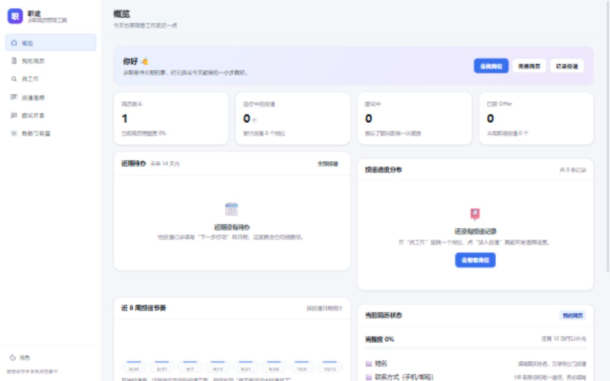
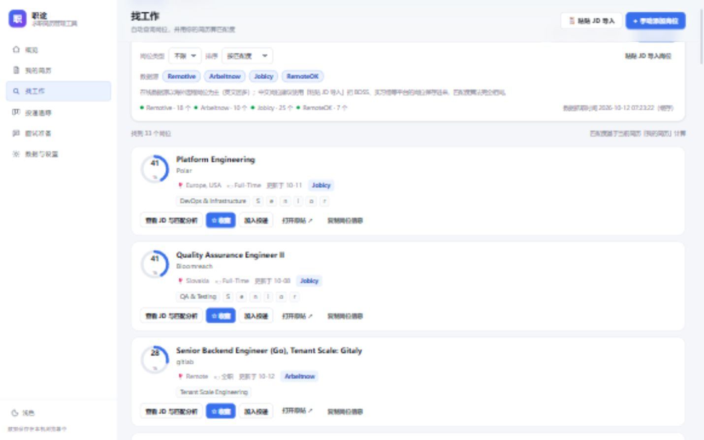

# 职途 · 求职简历管理工具

一个为大三大四学生准备的求职工作台：管理简历、自动查询岗位、算匹配度、追踪投递进度、准备面试。
界面简洁，双击 `start.bat` 即可使用，**不需要安装任何第三方依赖**（只需电脑上有 Python 3）。

> Zhitu · Job-hunting toolkit for college students: resume builder, job search with match scoring, application tracker and interview prep. Zero dependencies, runs locally with a double click.

## 下载与安装

**方式一：下载打包好的压缩包（推荐给不想折腾的同学）**

1. 到仓库的 [Releases](../../releases) 页面下载最新的 `zhitu-job-toolkit-v1.0.0.zip`。
2. 解压到任意目录（路径里尽量不要有空格以外的特殊字符）。
3. 双击解压出来的 `start.bat`，浏览器会自动打开工具页面。

**方式二：直接使用源码**

```bat
git clone <本仓库地址>
cd zhitu-job-toolkit
start.bat
```

## 快速开始

1. 确认电脑已安装 Python 3.8 以上版本（命令行输入 `python --version` 能看到版本号即可）。
2. 双击项目根目录下的 **`start.bat`**。
3. 浏览器会自动打开 `http://127.0.0.1:8765/`，开始使用。

> 关闭那个黑色命令行窗口即可停止服务。
> 如果端口被占用，脚本会自动换到 8766、8767 等端口，并按屏幕提示的地址访问。

## 界面预览





## 功能一览

| 模块 | 能做什么 |
| --- | --- |
| 概览 | 简历完整度、进行中投递、面试数、Offer 数；近 14 天待办提醒；投递阶段分布与近 8 周投递节奏 |
| 我的简历 | 多版本简历管理（针对不同岗位）、分区填写、实时预览、完整度体检、打印/另存为 PDF、导出 Markdown、复制纯文本用于网申粘贴 |
| 找工作 | 在线聚合 Remotive / Arbeitnow / Jobicy / RemoteOK 四个免费岗位源；按关键词与城市筛选；用你的简历自动算匹配度（技能/岗位方向/城市/学历/类型五个维度）；收藏、加入投递 |
| 粘贴 JD 导入 | 把 BOSS 直聘、实习僧、牛客等平台的中文岗位复制粘贴进来，自动识别岗位名称、公司、城市、薪资、截止时间与技能关键词 |
| 投递追踪 | 看板（想投 → 已投递 → 笔试测评 → 面试中 → 已获 Offer → 已结束）+ 列表视图；拖拽改阶段；下一步行动与截止日提醒；转化率与平均反馈等待天数；导出 CSV |
| 面试准备 | 40+ 道常见问题分类题库与答题思路；记录自己的回答要点与掌握程度；STAR 故事生成器；面试复盘记录 |
| 数据与设置 | 一键导出/导入全部数据（JSON）、载入示例简历、清空数据、求职偏好与数据源开关 |

## 关于岗位数据

- 在线数据源都是**公开免费接口**，无需申请 Key，以海外与远程岗位为主（英文居多）。
- 中文招聘平台（BOSS 直聘、实习僧等）没有公开接口，推荐用「粘贴 JD 导入」把岗位存进「我的岗位库」，匹配度算法与在线岗位完全一致。
- 岗位信息仅供检索参考，投递前请点击「打开原站」确认最新内容；请在转载/分享时保留数据来源标注（Remotive、Arbeitnow、Jobicy、RemoteOK）。
- 在线抓取有 10 分钟缓存；若网络不可用，会自动回落到内置的示例岗位库，界面照常可用。

## 数据保存在哪里

所有简历、投递记录、面试笔记都保存在**本机浏览器的 localStorage** 中，不会上传到任何服务器。
因此：

- 换电脑、换浏览器、清理浏览器数据前，请先到「数据与设置」导出 JSON 备份。
- 用不同浏览器（Chrome / Edge）打开，看到的是各自独立的数据。

## 项目结构

```
server.py              本地服务器（Python 标准库，提供静态页面 + 岗位聚合接口）
start.bat              Windows 一键启动
使用说明.txt             给完全不懂技术的同学看的图文版上手说明
scripts/
  build-release.ps1    重新打包 dist/ 下的发布压缩包
  publish.ps1          发布到 GitHub（建仓库、推送、打标签）
web/
  index.html           页面骨架
  css/styles.css       全部样式（含深色主题与打印样式）
  js/
    util.js            日期、弹窗、提示、复制/下载等基础工具
    skills.js          技能词典、JD 技能提取、匹配度算法、简历完整度
    store.js           数据层（本地存储、增删改查）
    api.js             岗位数据获取与离线回落
    jd.js              中文 JD 解析
    interview-bank.js  面试题库内容
    views/             六个页面的渲染与交互
    app.js             路由、顶栏、各类弹窗表单、快捷键
  data/seed-jobs.json  内置示例岗位（离线可用）
.cache/                岗位搜索缓存（自动生成）
```

## 打包与发布（维护者）

```powershell
# 重新打包发布压缩包，产物在 dist/ 下
powershell -ExecutionPolicy Bypass -File scripts\build-release.ps1 -Version 1.0.0

# 发布到 GitHub（未安装 gh 时加 -SkipCreate，先在网页建好空仓库）
powershell -ExecutionPolicy Bypass -File scripts\publish.ps1 -Owner 你的GitHub用户名
```

发布完在 Releases 页面把 `dist\zhitu-job-toolkit-v1.0.0.zip` 作为附件上传，使用者就能一键下载解压即用了。

## 常用快捷键

| 按键 | 作用 |
| --- | --- |
| `/` | 跳到「找工作」并聚焦搜索框 |
| `n` | 快速新建投递记录 |
| `Esc` | 关闭弹窗 |

## 岗位匹配度是怎么算的

总分 100，由五个维度加权得到：

- 技能匹配 50%：岗位要求的技能里，你简历中已出现的比例（出现在标题里的关键技能权重更高）
- 岗位方向 18%：目标岗位关键词与岗位名称的吻合程度
- 城市 12%：期望城市与岗位地点/远程属性是否一致
- 学历要求 10%：岗位要求学历与你最高学历的差距
- 岗位类型 10%：实习 / 校招 / 全职与你的期望是否一致

在岗位卡片里点「查看 JD 与匹配分析」，可以看到每个维度的得分与缺失技能，方便你补齐简历或提前准备面试。
